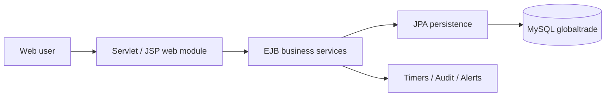

<div align="center">


**Enterprise-style supply chain management • Jakarta EE • Payara • MySQL**


</div>

## Overview

**GlobalTrade** is a multi-module Jakarta EE project for managing supply chain operations, including vendors, stock, shipments, customs documentation, audit logs and operational alerts.

## Core Modules

| Module | Purpose |
|---|---|
| Inventory | Stock monitoring and reorder information |
| Vendors | Supplier records and performance |
| Shipments | Dispatches, tracking and delivery statuses |
| Customs | Customs documentation and deadline tracking |
| Audit trail | Record operational actions |
| Dashboard & alerts | Operational overviews and notifications |
| Access management | Multiple user roles and authentication |

## Technology

Java 17 • Jakarta EE • EJB • JPA • Servlet/JSP • Maven multi-module • Payara 6 • MySQL • PBKDF2-HMAC-SHA256

## Architecture



## Project Structure

```text
GlobalTrade/
├── globaltrade-web/        # Web UI and servlets
├── globaltrade-ejb/        # Business logic and entities
├── globaltrade-ear/        # Payara EAR packaging / JDBC resources
├── database/               # SQL schema and demo domain data
├── testing/                # Performance test assets
├── tools/                  # Local-only user-password setup
└── pom.xml                 # Maven parent project
```

## Local Setup

1. Install **JDK 17**, **Payara Server 6**, **Maven**, and **MySQL**.
2. Import `database/globaltrade_db.sql` into MySQL. It creates the **`globaltrade`** database and domain demo records but deliberately **does not create login accounts**.
3. Set the **local** MySQL username/password in `globaltrade-ear/src/main/application/META-INF/payara-resources.xml`. The committed password is intentionally blank. **Do not commit real credentials**; restore the blank placeholder before pushing future changes.
4. Generate your own local login passwords:

   ```powershell
   python tools/create_local_users.py
   ```

   Enter new passwords for whichever accounts you need: `admin`, `logistics`, `warehouse`, `customs`, `vendor`, `customer` (press Enter to skip an account). This writes **`local_users.sql`**, which is ignored by Git.
5. Import `local_users.sql` into your local MySQL database. **The script generates hashes, not a plaintext password list.** Keep your chosen passwords safely stored.
6. Build with `mvn clean package` from the project root; deploy the generated EAR to Payara and verify the JDBC pool/resource configuration.

### Database login accounts

**There is no recoverable original password in a PBKDF2 hash.** The usernames above are included as optional local development accounts, but this public repository does not ship active login passwords. Generate your own using the included script.

### Security

- Real database credentials were removed from the committed Payara configuration.
- Precomputed login credential hashes were removed from the public SQL seed.
- Generated `local_users.sql` must remain local; it is excluded from Git.
- If a real database password was previously committed or reused, **rotate it** before publication; removing it from a new copy does not make old copies safe.
- The code has not received a full security audit. Review authentication, authorization and SQL handling before production use.

## Project Status

Academic project. The archive was cleaned and inspected for GitHub publishing; **full Maven build, deployment and runtime testing were not performed** in this preparation step.

---

<div align="center">

**Developed by [Akash Amarasinghe](https://github.com/AkashAmarasinghe)**


</div>
